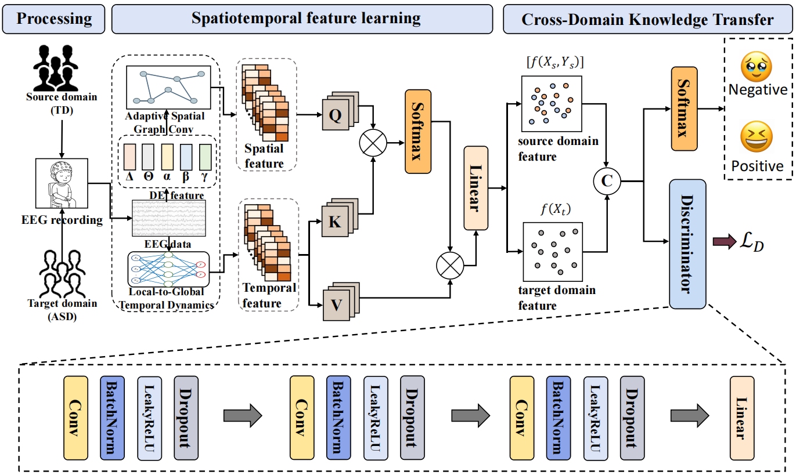

# PACT-Net

> PACT-Net（Prior-guided Adaptive Cross-domain Transfer Network）用于在没有 ASD 情绪标注的条件下，将典型发育儿童（TD）的 EEG 情绪知识迁移到孤独症谱系障碍（ASD）儿童，实现跨人群的 EEG 情绪识别。



## Abstract

Children with autism spectrum disorder (ASD) suffer emotional processing impairments, requiring objective EEG-based assessment for clinical intervention. However, large labeled ASD EEG datasets are hard to collect due to poor child compliance, and cross-group neurophysiological gaps degrade supervised model generalization. This work proposes the Prior-guided Adaptive Cross-domain Transfer Network (PACT-Net) for label-free ASD emotion recognition, transferring affective knowledge from typically developing (TD) children to autistic children. PACT-Net jointly optimizes three core modules: multiband differential entropy extracts frequency EEG cues; a prior-aware learnable graph models adaptive spatial brain connectivity; a local-to-global encoder captures transient temporal neural dynamics. An adversarial domain alignment module maps TD and ASD features into a shared latent space to reduce distribution discrepancy, with crossattention fusion boosting feature discriminability. In the TD-source ASD-target setup, our method reaches 92.53% accuracy and 92.50% F1-score on ASD test data, outperforming state-of-the-art methods by 9.51%. Without any ASD labels, PACT-Net attains comparable performance to supervised models trained on 50% ASD annotations.The results demonstrate that this spatiotemporal transfer framework holds significant potential as a robust and objective tool for clinical ASD emotion screening.The code is available at https://github.com/xiaoyu-yeah/PACT-Net.
## 技术栈

- 语言：Python 3.10+
- 深度学习：PyTorch、PyTorch Geometric、torch-scatter
- 数值与信号处理：NumPy、SciPy
- 图与数据处理：NetworkX、pandas
- 评估与可视化：scikit-learn、Matplotlib、Seaborn
- 加速：CUDA

## 环境要求

- Python >= 3.10
- PyTorch 与本机 CUDA 版本匹配
- PyTorch Geometric 及其依赖与 PyTorch 版本匹配
- ASD/TD 数据和 SEED 数据需要单独准备，仓库不包含原始 EEG 数据

## 数据与许可

ASD/TD EEG 数据涉及受试者隐私，不包含在本仓库中。SEED 数据集请按照其官方使用条款获取：[SEED Dataset](https://bcmi.sjtu.edu.cn/home/seed/)。本项目当前尚未附带独立开源许可证；如需公开发布，请根据数据许可和代码作者的授权补充 `LICENSE` 文件。

## 引用

如果本项目对你的研究有帮助，请引用：

```text
Xiaoyu Hu, Jingying Chen, Dan Chen, Zhiyi Yang, Yaodong Wang,
Siwei Chen, Chang Cai, and Tengfei Gao,
“PACT-Net: A Prior-Guided Adaptive Cross-Domain Transfer System
for Label-Free EEG Emotion Recognition in ASD.”
```
